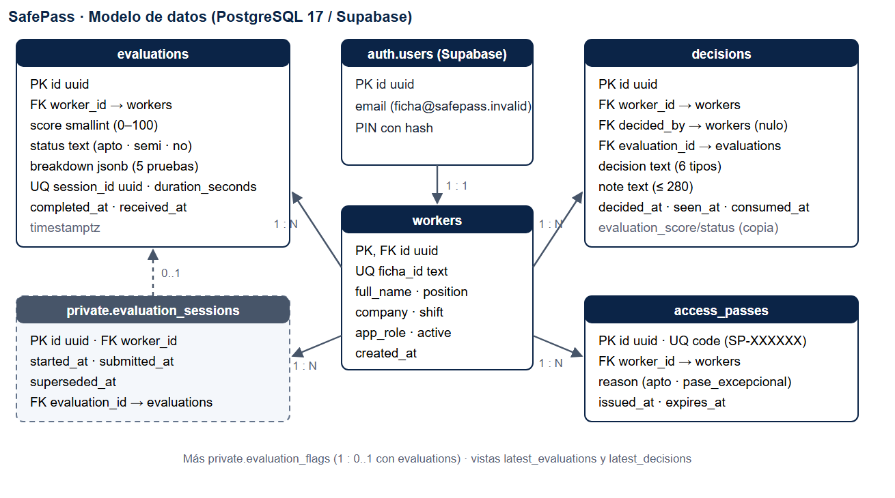

# Base de datos de SafePass

Motor: **PostgreSQL 17**, administrado por **Supabase** (que aporta además el inicio de sesión y el tiempo real).



| Archivo | Contenido |
|---|---|
| [`schema.sql`](./schema.sql) | Script que **crea la base desde cero**: tablas, restricciones, seguridad por fila (RLS), triggers y funciones del servidor |
| [`modelo-datos.png`](./modelo-datos.png) | Diagrama entidad-relación |

`schema.sql` es la unión, en orden cronológico, de las migraciones de [`../supabase/migrations`](../supabase/migrations), que son la fuente de verdad. Cada cambio de esquema se agrega como migración nueva (nunca se edita una ya aplicada) y este archivo se vuelve a generar.

## Crear la base

1. Crear un proyecto en [Supabase](https://supabase.com) (vacío).
2. Abrir **SQL Editor**, pegar el contenido de `schema.sql` y ejecutarlo completo.
   También sirve `supabase db push` con la CLI de Supabase, que aplica las migraciones en orden.
3. Crear los usuarios en **Authentication → Users**, con correo `FICHA@safepass.invalid` (por ejemplo `TRB-0512@safepass.invalid`) y un PIN como contraseña.
4. Insertar su perfil en `workers` (el `id` es el del usuario creado en el paso anterior):

```sql
insert into public.workers (id, ficha_id, full_name, position, company, shift, app_role)
values ('<id del usuario de Auth>', 'TRB-0512', 'Nombre Ficticio', 'Operador', 'Minera Demo', 'Día', 'worker');
-- app_role = 'supervisor' para la cuenta que valida pases y decide
```

5. Ajustes de Supabase Auth que **no** se versionan: desactivar el registro público, activar el CAPTCHA (con la clave secreta de Turnstile) y los límites de inicio de sesión.

> **Datos:** el repositorio no trae datos ni credenciales. Los trabajadores de la demostración son ficticios; no se cargan datos reales de personas en ningún entorno.

## Tablas

| Tabla | Contenido | Claves |
|---|---|---|
| `workers` | Perfil de cada Ficha ID | PK y FK `id` → `auth.users` (1:1); único `ficha_id` |
| `evaluations` | Resultado de cada batería: puntaje 0–100, estado, desglose, horas de término y de llegada | FK `worker_id`; único `session_id` |
| `decisions` | Decisiones del supervisor (o automáticas por NO APTO) | FK `worker_id`, `decided_by`, `evaluation_id` |
| `access_passes` | Pases `SP-XXXXXX` con vigencia de 12 h | FK `worker_id`; único `code` |
| `private.evaluation_sessions` | Sesiones de test (esquema privado, no expuesto por la API) | FK `worker_id`, `evaluation_id` |
| `private.evaluation_flags` | Marcas de resultados atípicos (solo las lee el supervisor) | PK y FK `evaluation_id` |

El detalle de columnas y tipos está en la sección 5 del [documento técnico](../docs/SafePass-Documento-Tecnico-Backend.pdf) y las reglas, en [`../docs/CONTRATO-API.md`](../docs/CONTRATO-API.md).
